# AI-Powered Unified Platform for Threat Hunting, DFIR and Threat Intelligence

> Summer internship project
> **The source code is private** (internship project). This repository presents the project, its architecture and its results.

<!-- CAPTURE 01: global dashboard / home page of the platform -->
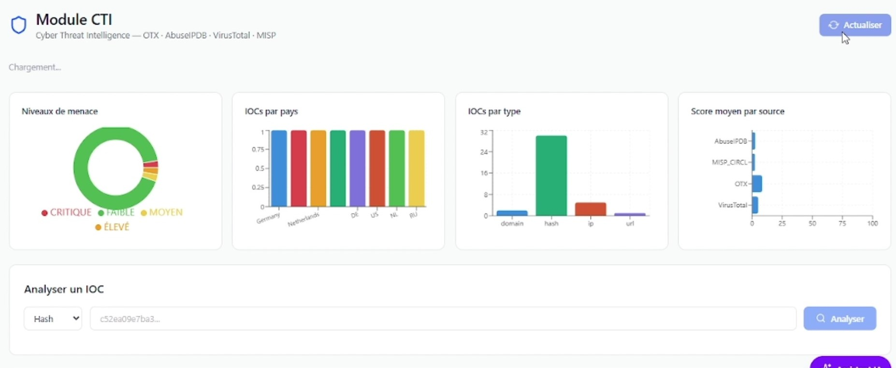

**Demo video:** [add your link here]

---

## The problem

CTI, Threat Hunting and DFIR are usually run in separate tools. During an incident, analysts correlate indicators, alerts and forensic evidence by hand, which slows down the investigation and risks missing evidence.

## The solution

A unified platform where the modules share data automatically: an IOC found while hunting is enriched by CTI, attached to a DFIR case, and matched against the forensic artifacts collected from the endpoint. An AI layer assists the analyst, and a light SOAR layer sends the alert.

## Key figures

| | |
|---|---|
| **4** threat intelligence sources queried in parallel | OTX, VirusTotal, AbuseIPDB, MISP CIRCL |
| **11,700+** Windows events collected in real time | Sysmon → Winlogbeat → Elasticsearch |
| **13+** Sigma / YARA rules operated | with one-click install from GitHub |
| **3 %** false-positive rate | Isolation Forest retrained on 1,984 real Sysmon events |
| **5 Sigma + 1 YARA** alerts | on a simulated attack chain |
| **5** Docker services | API, frontend, MongoDB, Elasticsearch, n8n |

## Architecture

<!-- CAPTURE 02: copy global_architecture.png from the report -->
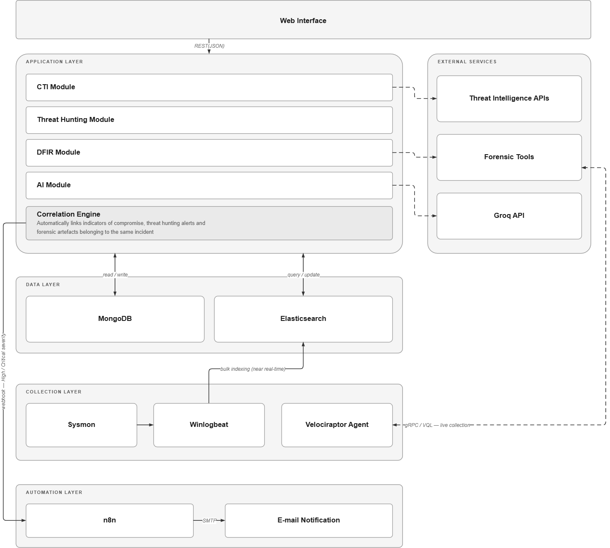

The platform has a React interface, a Flask API with four modules (CTI, Threat Hunting, DFIR, AI) tied together by a correlation engine, a storage layer (MongoDB and Elasticsearch), a data collection layer on the monitored endpoint, and an n8n automation layer.

### Real-time collection pipeline

<!-- CAPTURE 03: copy pipeline.png from the report -->
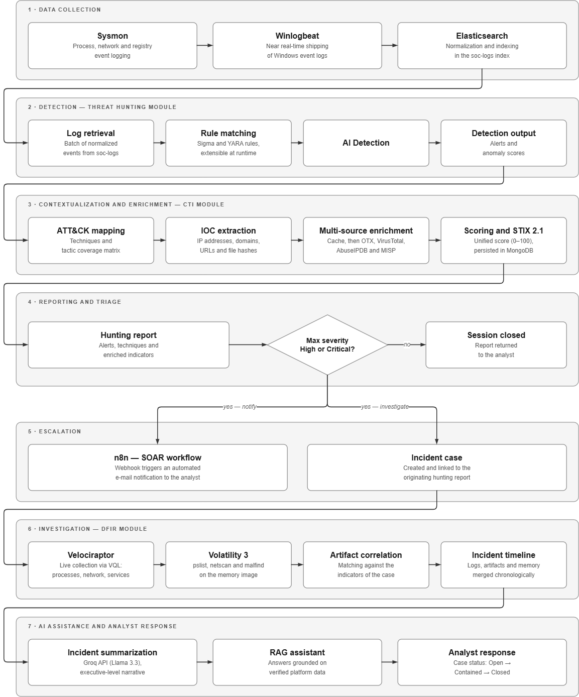

Sysmon captures process, network and registry events on a Windows VM. Winlogbeat ships them to Elasticsearch, where a normalization step maps them to a unified schema. The normalized event keeps the platform fields **and** the Sysmon fields (parent process, hashes, integrity level), and archives the raw event, so no forensic information is lost. Deterministic document IDs make the pipeline idempotent: re-running it never creates duplicates.

## Modules

### 1. Cyber Threat Intelligence

- Enrichment of IP, domain, hash and URL indicators from four sources, queried in parallel
- Weighted risk score (weights depend on the indicator type) and severity level
- STIX 2.1 output with custom properties to keep the enriched context
- MongoDB cache to avoid repeated API calls

<!-- CAPTURE 04: detail of an enriched IOC (score, sources, geolocation, Tor flag) -->
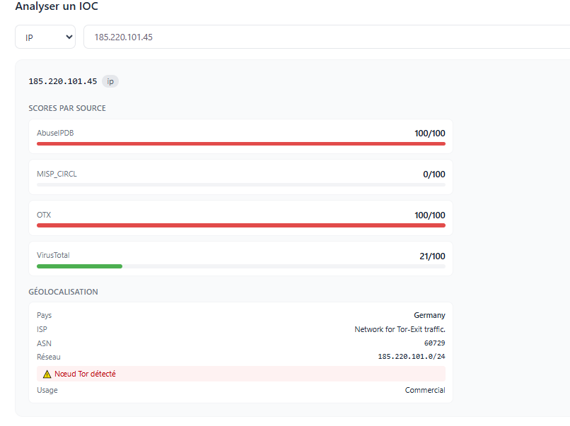

### 2. Threat Hunting

- Sigma and YARA detection, plus an Isolation Forest anomaly detector
- Unified detections table: each threat shows which engine(s) detected it, its MITRE technique and its anomaly score
- MITRE ATT&CK matrix
- Search and one-click install of community rules (SigmaHQ, Neo23x0) through the GitHub API
- Automatic IOC extraction (IPs, domains, URLs, Sysmon file hashes) forwarded to CTI

<!-- CAPTURE 05: Hunting dashboard stat cards -->
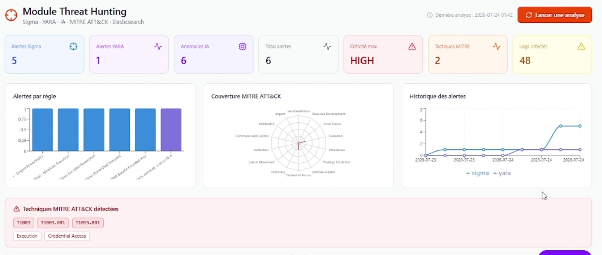

<!-- CAPTURE 06: unified detections table with engine badges -->
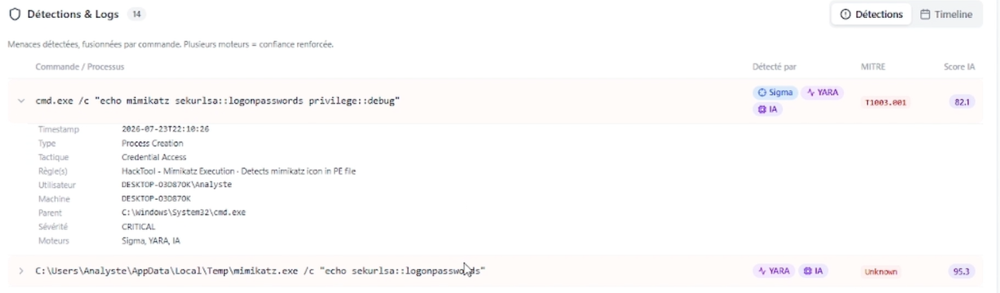

<!-- CAPTURE 07: MITRE ATT&CK matrix -->
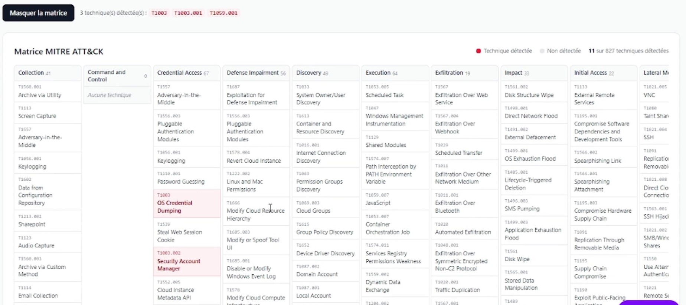

<!-- CAPTURE 08: rule search and installed rules -->
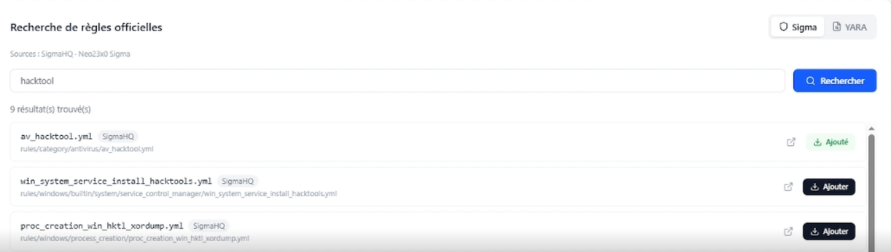
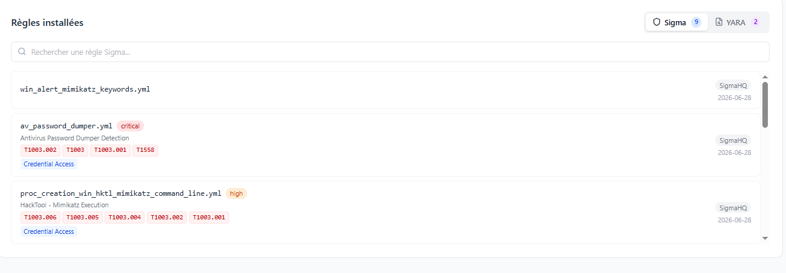

### 3. Digital Forensics and Incident Response

- Case created from a hunting report, linked to it by a strict identifier so that incidents never mix
- Response workflow: Open, In Progress, Contained, Resolved, Closed
- Live collection with Velociraptor (processes, network, services) over gRPC
- Memory forensics with Volatility 3, including injection detection (`malfind`)
- Artifacts automatically correlated with the case IOCs and infected logs
- Consolidated timeline merging logs, live artifacts and memory findings, with MITRE mitigations

<!-- CAPTURE 09: case detail (workflow, alerts, IOCs, MITRE) -->

<!-- CAPTURE 10: Velociraptor / Volatility cards and correlated artifacts -->
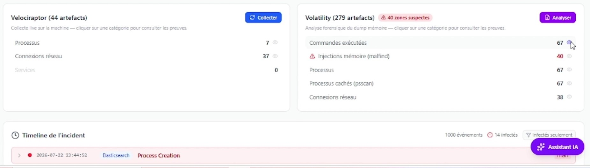

<!-- CAPTURE 11: incident timeline with one expanded event -->
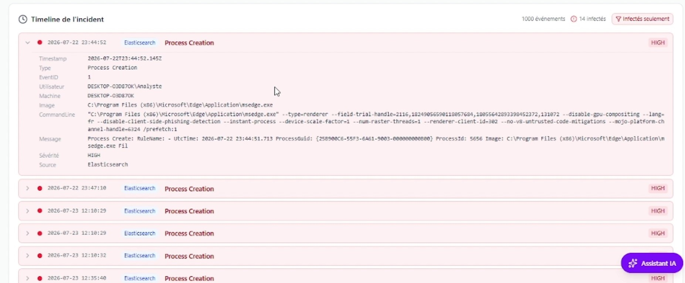

### 4. Artificial Intelligence

| Component | Approach |
|---|---|
| Anomaly detection | Isolation Forest, 11 engineered features (command length and entropy, offensive keywords, rare process, suspicious path, external IPs, privileged user...), score calibrated to 0-100. Benchmarked against One-Class SVM (F1 0.68, recall 0.79 on a 5,000-log labeled set), then retrained on real Sysmon data (3 % false positives) |
| Threat classification | Random Forest vs XGBoost on 5 ATT&CK-aligned families, with an explicit train/test check against overfitting |
| Incident summary | LLM (Llama 3.3 via Groq) turns the case data into an executive summary |
| Analyst assistant | RAG: the question triggers a retrieval from MongoDB (IOCs, cases, reports) and the retrieved data is injected into the prompt, so answers stay grounded in platform data |

<!-- CAPTURE 12: AI summary and a chatbot answer -->
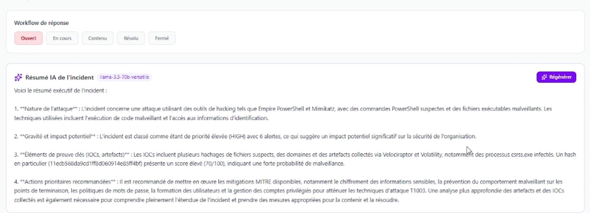
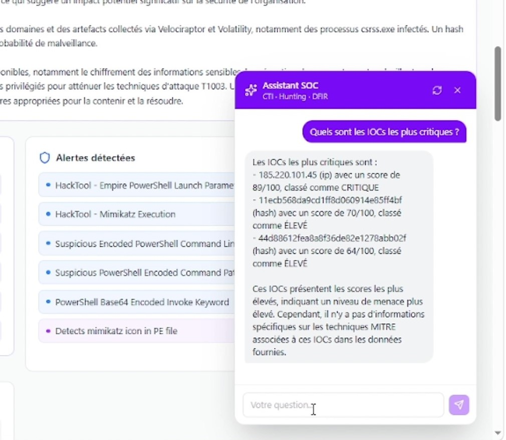

<!-- CAPTURE 13: terminal output of the model results -->
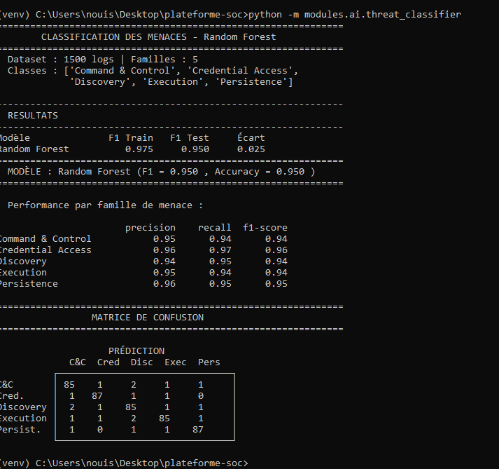
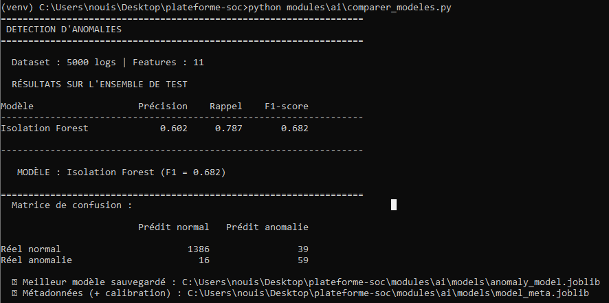
### 5. Security automation (SOAR)

An n8n workflow receives a webhook from the hunting pipeline when severity is High or Critical, filters it, and emails the analyst an HTML incident summary (severity, alerts per engine, MITRE techniques).

<!-- CAPTURE 14: n8n workflow canvas -->
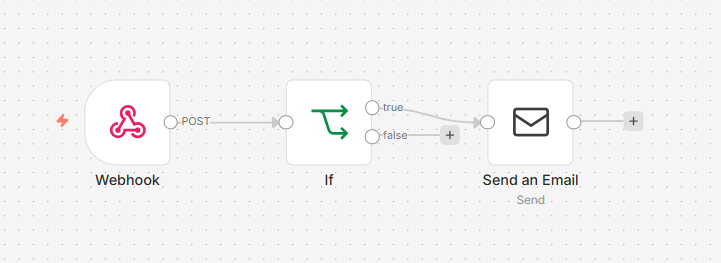

<!-- CAPTURE 15: the HTML alert email -->
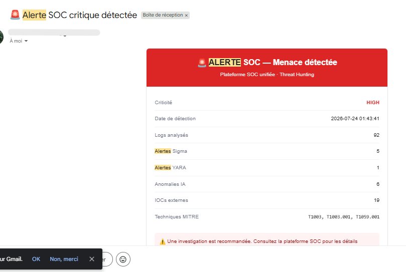

## End-to-end scenario

1. On the monitored VM, a credential-access command, an encoded PowerShell command and a scheduled task are executed (simulations, no real malware).
2. Sysmon and Winlogbeat ship the events; they are normalized into the unified schema.
3. The hunting analysis flags them with Sigma, YARA and the anomaly detector, and maps them to MITRE ATT&CK.
4. Extracted IOCs are enriched by CTI and a DFIR case is created.
5. Velociraptor and Volatility artifacts are correlated to the case and merged into the timeline.
6. The analyst receives the automatic email.

<!-- CAPTURE 16: attack simulation commands on the VM -->

## Tech stack

Python, Flask, React, Tailwind CSS, MongoDB, Elasticsearch, Sysmon, Winlogbeat, Sigma, YARA, MITRE ATT&CK, STIX 2.1, Velociraptor, Volatility 3, scikit-learn, XGBoost, Groq API (Llama 3.3), n8n, Docker Compose.

## Skills demonstrated

- Detection engineering: Sigma and YARA, MITRE ATT&CK mapping, log normalization
- Threat intelligence: multi-source enrichment, scoring, STIX 2.1
- DFIR: live collection, memory analysis, artifact correlation, timelines
- Applied machine learning: feature engineering, model comparison, overfitting control, calibration
- LLM integration: RAG architecture, grounded responses
- Automation and deployment: n8n workflows, Docker Compose

## Limitations and roadmap

**Current limitations**
- Prototype with no authentication or access control
- A single monitored endpoint; the collection pipeline is not a full multi-source SIEM
- The classifier is trained on a synthetic dataset and is not yet wired into the live hunting pipeline
- RAG retrieval is keyword-based, not vector-based

**Roadmap**
- Dark web threat intelligence sources
- Local LLM deployment to keep incident data on-premise
- Authentication, role-based access control and audit logging
- Scoring ML for IOCs and disk forensics

## Author

**Oumaima Nouisser**, Cybersecurity Engineering student, EPI Sousse
Supervisor: Mr. Jasser Guesmi

[LinkedIn](https://linkedin.com/in/oumaima-nouisser) · [GitHub](https://github.com/nnouisser) · nouisseroumaima@gmail.com
